

  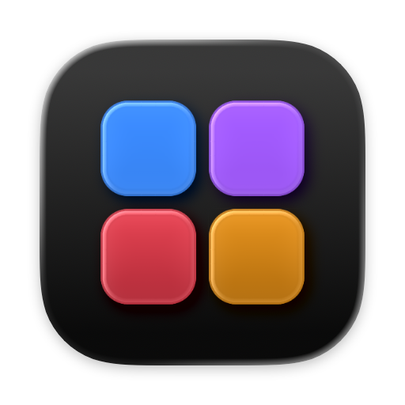

<h1 align="center">BetterKit</h1>

  Smooth scrolling, HiDPI, Vietnamese typing and fan control in one menu bar app for macOS.

  <strong>English</strong> · <a href="README.vi.md">Tiếng Việt</a>

  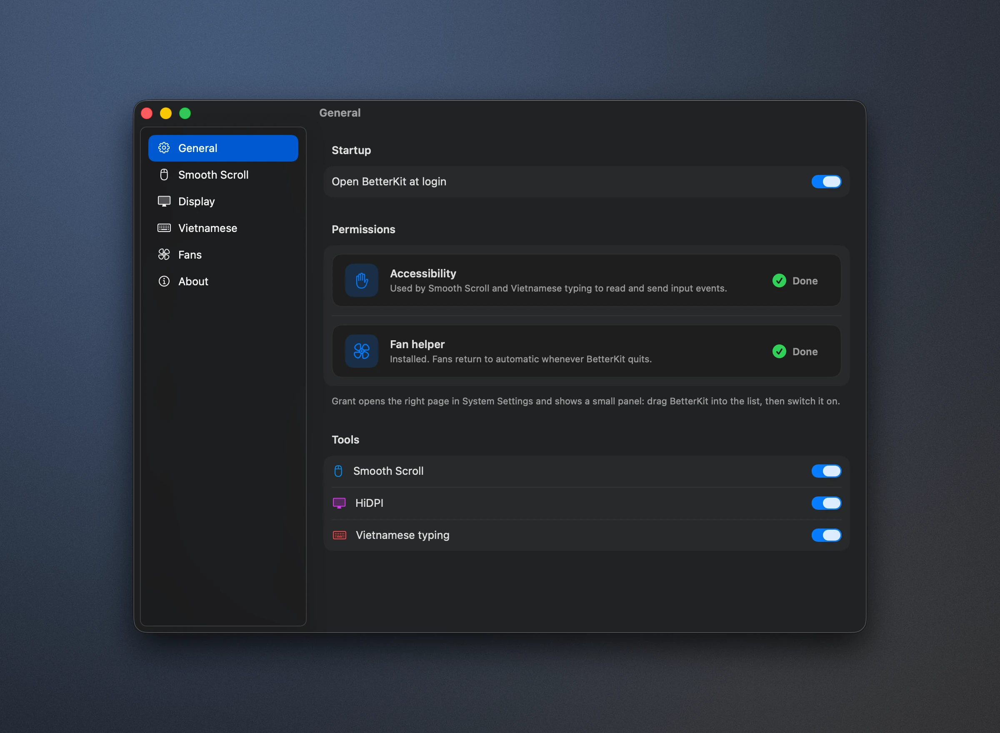

## Overview

BetterKit brings four everyday Mac utilities into a single, native menu bar app. Each tool can be turned on or off on its own, and all of them share one settings window, one permission setup and one update channel.

| Tool | Replaces | Summary |
| --- | --- | --- |
| Smooth Scroll | Mos | Eased, inertial scrolling for mouse wheels. Trackpads and Magic Mouse are left untouched. |
| Display | BetterDisplay (HiDPI) | Sharp 2x rendering on 1080p external displays, with brightness and contrast over DDC. |
| Vietnamese typing | EVKey | Telex, VNI and Simple Telex, powered by the [uvie](https://github.com/uvie-project/uvie-rs) engine. |
| Fans | Macs Fan Control | Live fan speed and temperature sensors, with automatic, constant speed or curve control. |

**Requirements:** a Mac with Apple Silicon and macOS 14 Sonoma or later.

## Features

### Smooth Scroll

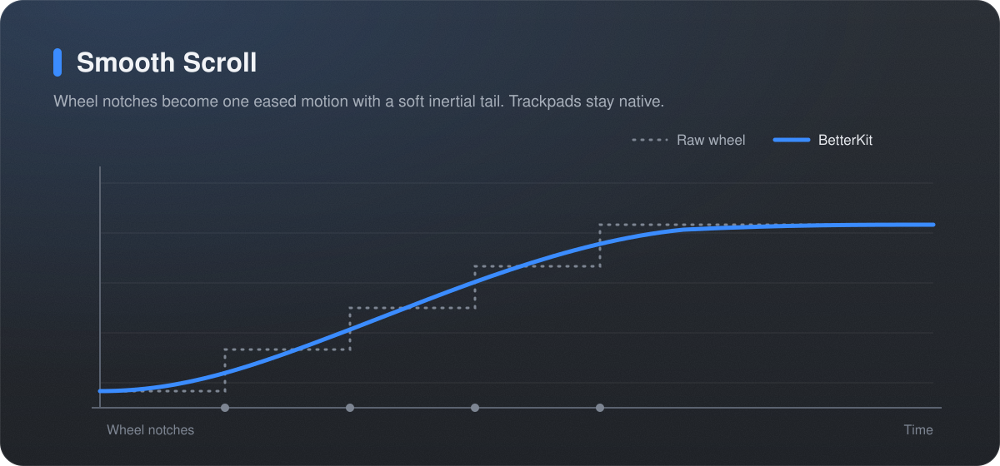

- Turns discrete wheel notches into one continuous motion with a soft start and an inertial tail.
- Adjustable step, speed and duration, plus an option to reverse the wheel direction.
- Per-app exceptions for apps that should receive raw wheel events.

### HiDPI on non-Retina displays

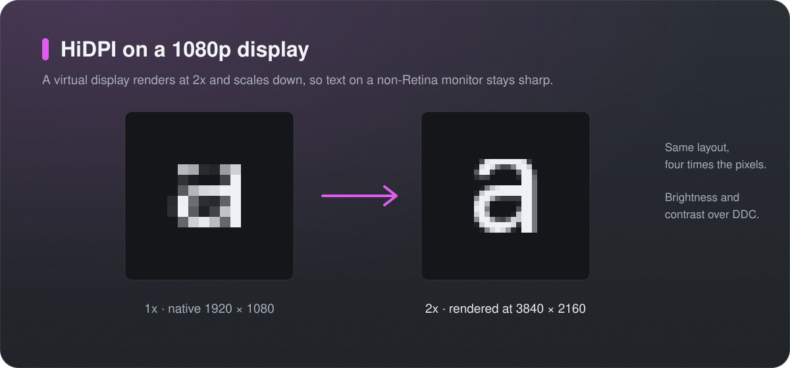

- Renders a 1080p display at 3840 × 2160 and scales it down, so the layout stays the same while text becomes noticeably sharper.
- Restores the selected mode at login and removes the virtual display when BetterKit quits, so the screen is never left mirrored.
- Brightness and contrast control over DDC/CI, with a brightness slider directly in the menu.

### Vietnamese typing

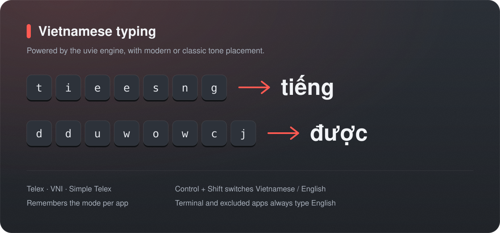

- Telex, VNI and Simple Telex input methods.
- Control + Shift switches between Vietnamese and English; the mode can be remembered per app.
- Modern (`hoà`, `thuỷ`) or classic (`hòa`, `thủy`) tone placement.
- Terminal and any app in the exclusion list always type English.

### Fan control

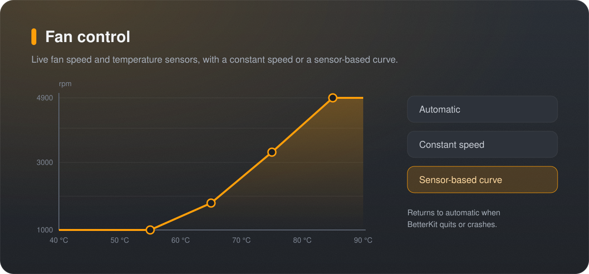

- Live fan speeds and temperature sensors.
- Automatic, constant speed or a sensor-based curve.
- A small privileged helper writes fan settings and returns the fans to automatic control whenever BetterKit quits or crashes.

## Screenshots

<table>
  <tr>
    <td width="50%">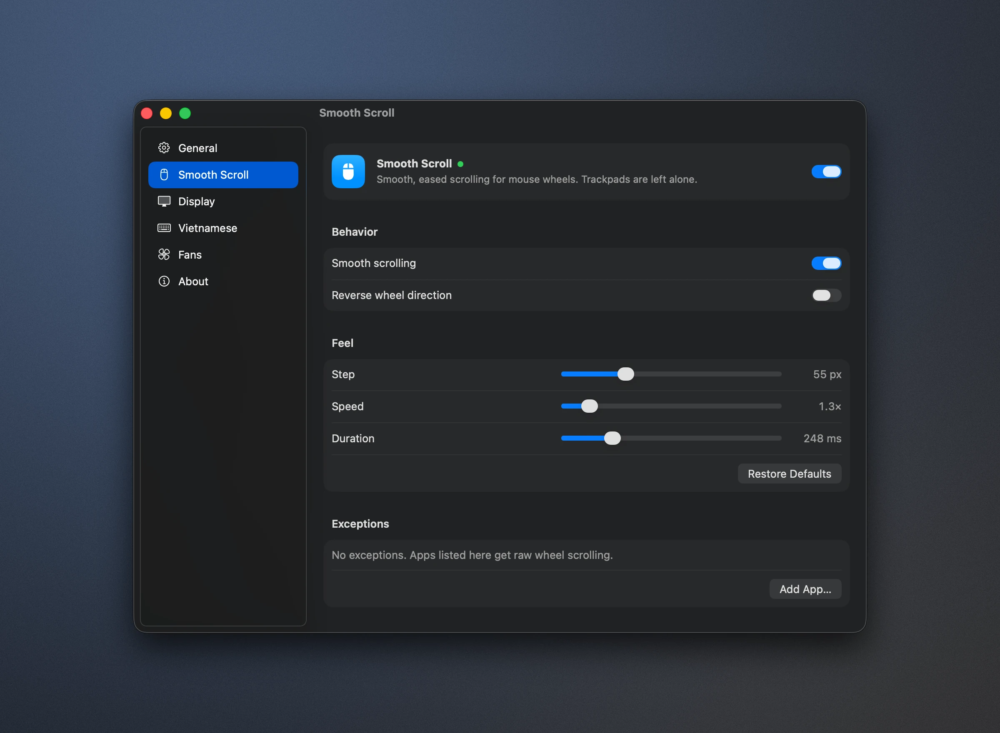</td>
    <td width="50%">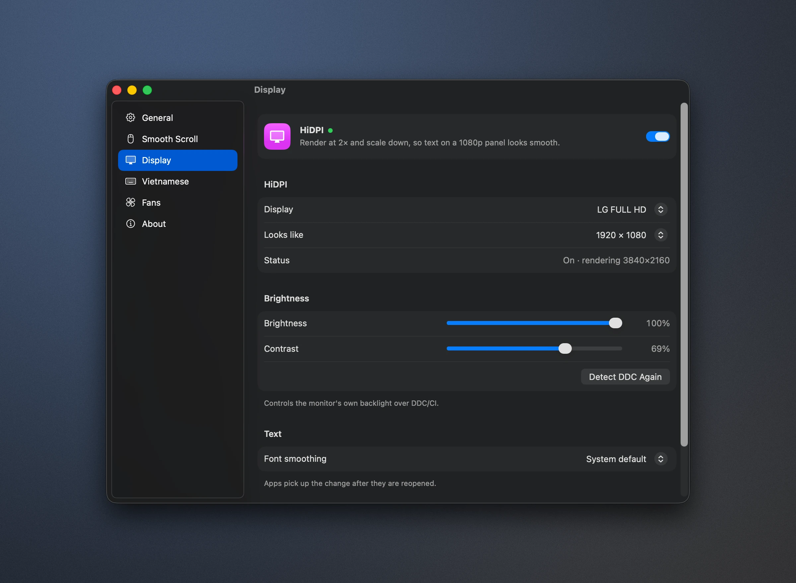</td>
  </tr>
  <tr>
    <td align="center">Smooth Scroll</td>
    <td align="center">Display</td>
  </tr>
  <tr>
    <td width="50%">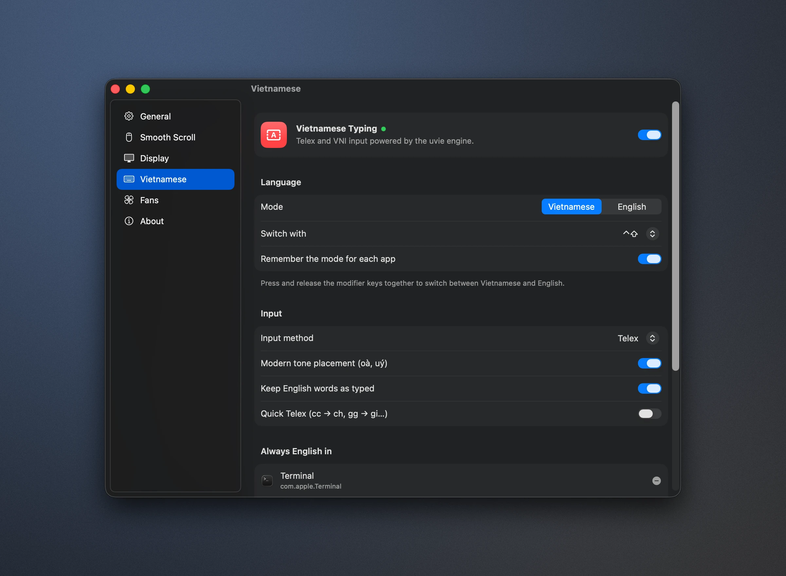</td>
    <td width="50%">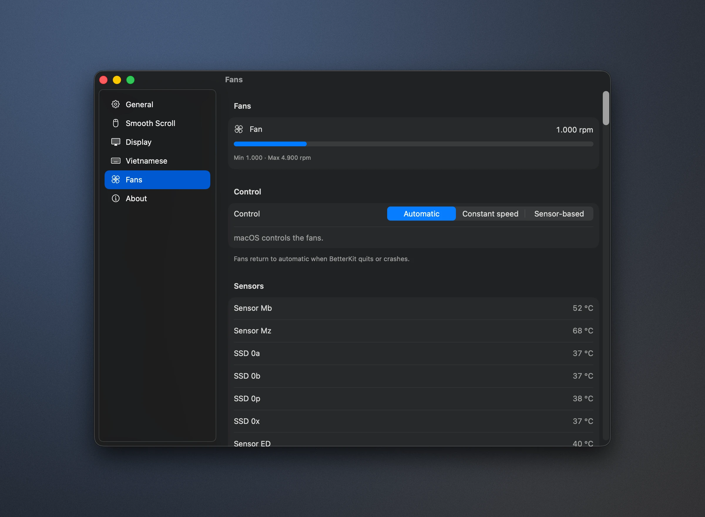</td>
  </tr>
  <tr>
    <td align="center">Vietnamese typing</td>
    <td align="center">Fans</td>
  </tr>
  <tr>
    <td width="50%">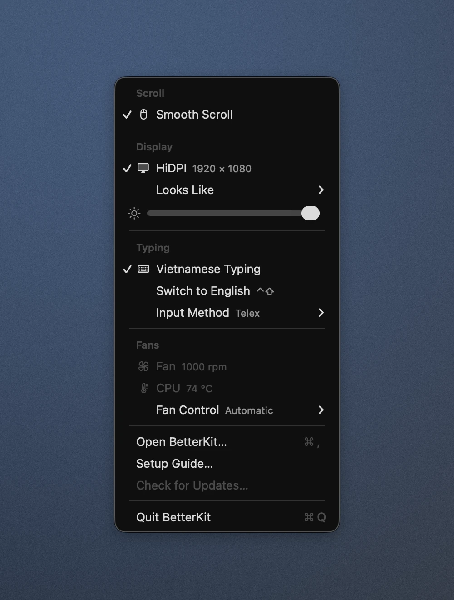</td>
    <td width="50%">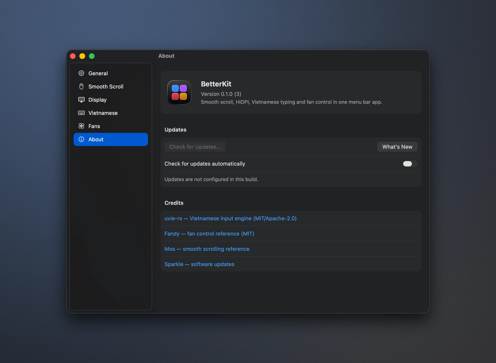</td>
  </tr>
  <tr>
    <td align="center">Menu bar</td>
    <td align="center">About</td>
  </tr>
</table>

## Installation

1. Open `BetterKit-<version>.dmg` and drag **BetterKit** to **Applications**.
2. Launch BetterKit. The setup window opens on first launch:
   - Turn on the tools you want to use.
   - **Accessibility:** click **Grant**. System Settings opens next to a small panel. Drag the BetterKit icon from the panel into the list and switch it on. Smooth Scroll and Vietnamese typing require this permission.
   - **Fan control:** open **Fans** in BetterKit and click **INSTALL** next to the fan helper. macOS asks you to allow BetterKit under *Login Items & Extensions › Allow in the Background*; the same panel shows where. Click **APPROVE** if the row is still waiting.
   - **Open at login** is enabled by default.
3. Quit any older apps that provide the same features to avoid conflicts.

Everything is available from the menu bar icon (the grid icon followed by **V** or **E**). **Open BetterKit…** (⌘,) shows all settings, and **Setup Guide…** reopens the setup window.

## Usage notes

- **HiDPI:** choose *Display › HiDPI* in the menu, then pick a size under *Looks Like*.
- **Tone placement:** *Modern tone placement* puts the tone mark on the main vowel (`hoà`, `thuỷ`). Turn it off in the Vietnamese settings for the classic style (`hòa`, `thủy`).
- **Excluded apps:** Terminal and every app in the *Always English in* list type English regardless of the current mode.
- **Fans** always return to automatic control when BetterKit quits or crashes.

## Uninstalling

1. Choose *Fans › Fan Control › Automatic*, then quit BetterKit.
2. Remove BetterKit from *System Settings › General › Login Items & Extensions* and from *Privacy & Security › Accessibility*.
3. Move `/Applications/BetterKit.app` to the Trash.

## Troubleshooting

| Symptom | Resolution |
| --- | --- |
| Scrolling or typing stops working after an update | Remove BetterKit from *Accessibility* with the **–** button, then grant access again. |
| The fan helper is waiting for approval | Allow BetterKit under *Login Items & Extensions › Allow in the Background*, then click **APPROVE** in **Fans**. |
| The screen looks blurry or stays mirrored | Turn HiDPI off and on again from the menu. Quitting BetterKit always removes the virtual display. |

## Development

Build instructions, project layout, debugging and the release process are documented in [docs/development.md](docs/development.md).

## Acknowledgements

- [uvie-rs](https://github.com/uvie-project/uvie-rs): Vietnamese input engine (MIT / Apache-2.0).
- [Fandy](https://github.com/NidaleNieve/Fandy_MacOS) and Macs Fan Control: reference for SMC fan control.
- [Mos](https://github.com/Caldis/Mos): reference for smooth scrolling.
- [Sparkle](https://sparkle-project.org): software updates.
