

  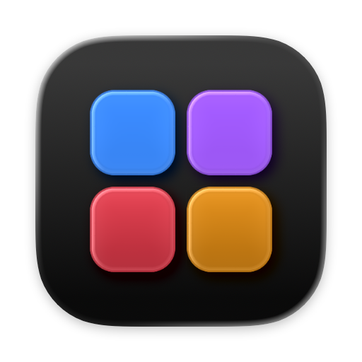

<h1 align="center">BetterKit</h1>

  Cuộn mượt, HiDPI, gõ tiếng Việt và điều khiển quạt trong một ứng dụng thanh menu cho macOS.

  
  
  
  
  
  

  <a href="README.md">English</a> · <strong>Tiếng Việt</strong>

  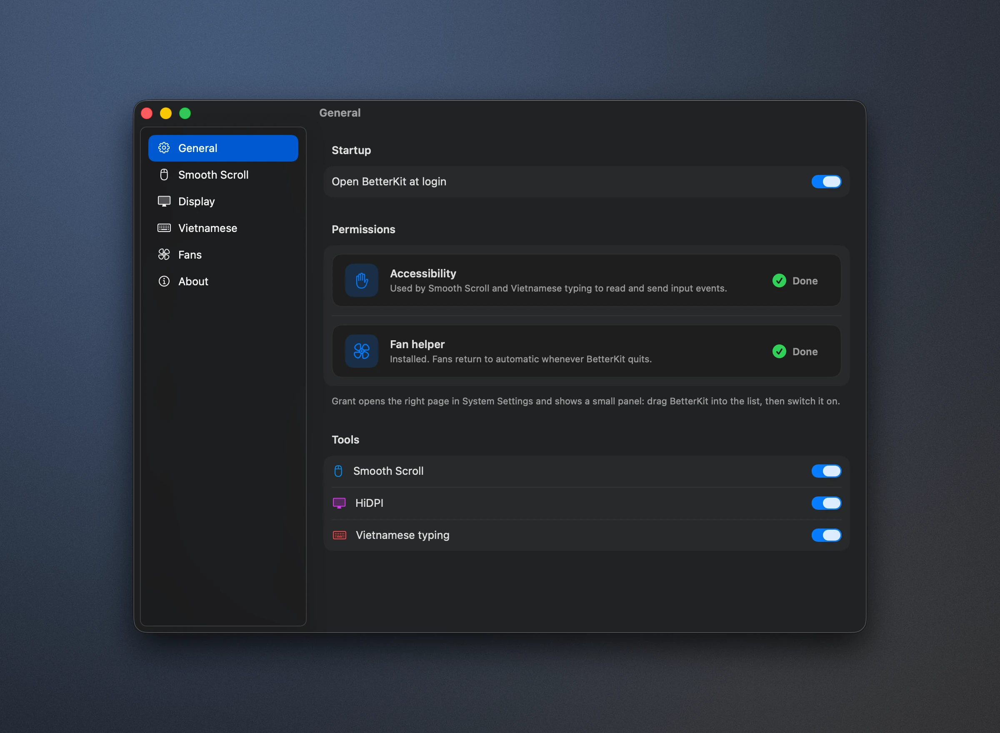

## Tổng quan

BetterKit gộp bốn tiện ích quen thuộc trên Mac vào một ứng dụng thanh menu gốc duy nhất. Mỗi công cụ có thể bật hoặc tắt riêng, và tất cả dùng chung một cửa sổ cài đặt, một quy trình cấp quyền và một kênh cập nhật.

| Công cụ | Thay thế | Tóm tắt |
| --- | --- | --- |
| Smooth Scroll | Mos | Cuộn chuột có gia tốc và quán tính. Trackpad và Magic Mouse giữ nguyên hành vi gốc. |
| Display | BetterDisplay (HiDPI) | Hiển thị sắc nét ở mức 2x trên màn hình ngoài 1080p, chỉnh độ sáng và tương phản qua DDC. |
| Gõ tiếng Việt | EVKey | Telex, VNI và Telex đơn giản, dùng bộ gõ [uvie](https://github.com/uvie-project/uvie-rs). |
| Quạt | Macs Fan Control | Theo dõi tốc độ quạt và cảm biến nhiệt độ; chế độ tự động, tốc độ cố định hoặc theo đường cong. |

**Yêu cầu:** máy Mac dùng chip Apple Silicon, macOS 14 Sonoma trở lên.

## Tính năng

### Cuộn mượt

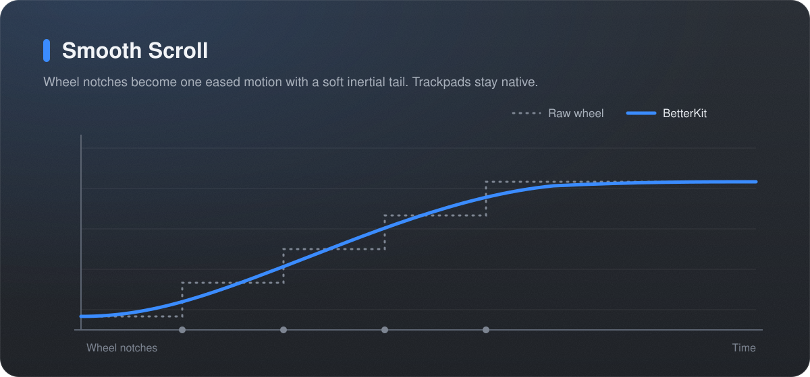

- Biến từng nấc cuộn rời rạc thành một chuyển động liền mạch, khởi đầu êm và có đuôi quán tính.
- Tùy chỉnh bước cuộn, tốc độ và thời lượng; có tùy chọn đảo chiều con lăn.
- Danh sách ngoại lệ cho những ứng dụng cần nhận sự kiện cuộn gốc.

### HiDPI cho màn hình không Retina

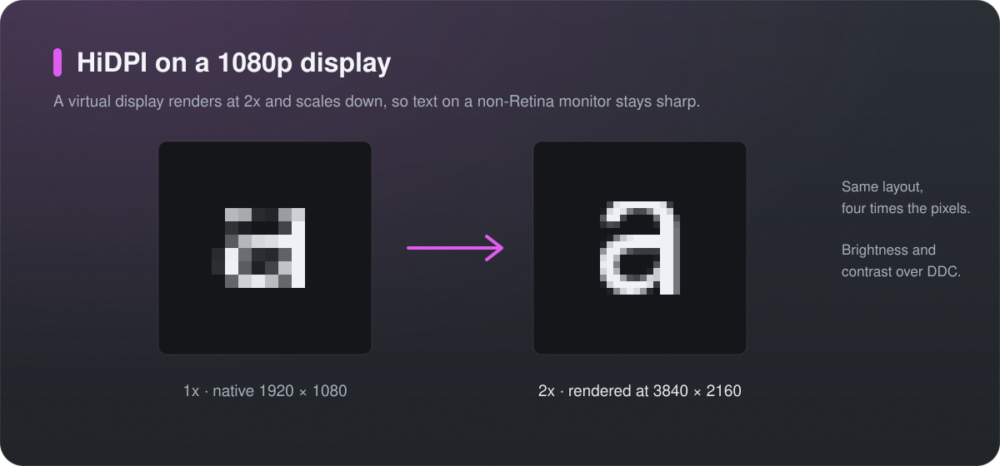

- Kết xuất màn hình 1080p ở độ phân giải 3840 × 2160 rồi thu nhỏ lại: bố cục giữ nguyên nhưng chữ sắc nét hơn rõ rệt.
- Tự khôi phục chế độ đã chọn khi đăng nhập và gỡ màn hình ảo khi thoát BetterKit, nên màn hình không bao giờ bị kẹt ở trạng thái phản chiếu.
- Điều chỉnh độ sáng và tương phản qua DDC/CI, có thanh trượt độ sáng ngay trong menu.

### Gõ tiếng Việt

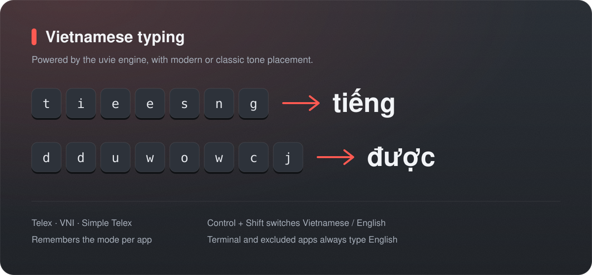

- Hỗ trợ các kiểu gõ Telex, VNI và Telex đơn giản.
- Control + Shift chuyển giữa tiếng Việt và tiếng Anh; có thể ghi nhớ chế độ gõ cho từng ứng dụng.
- Đặt dấu kiểu mới (`hoà`, `thuỷ`) hoặc kiểu cũ (`hòa`, `thủy`).
- Terminal và các ứng dụng trong danh sách loại trừ luôn gõ tiếng Anh.

### Điều khiển quạt

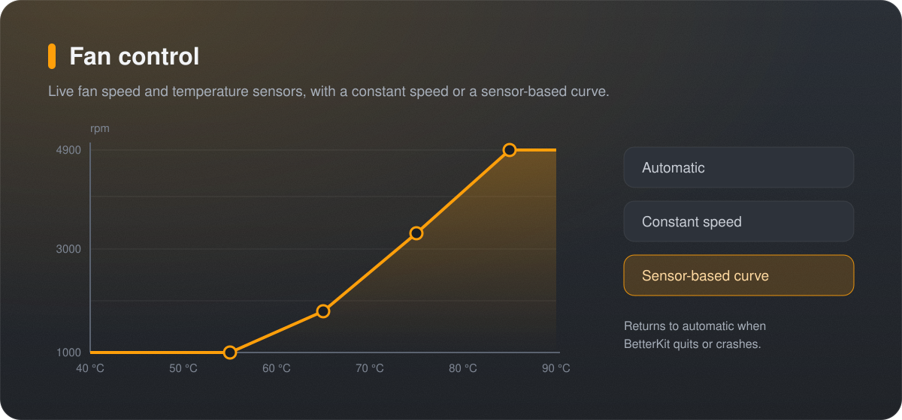

- Hiển thị trực tiếp tốc độ quạt và các cảm biến nhiệt độ.
- Chế độ tự động, tốc độ cố định hoặc đường cong theo cảm biến.
- Một helper đặc quyền nhỏ ghi thiết lập quạt và luôn trả quạt về chế độ tự động khi BetterKit thoát hoặc gặp sự cố.

## Ảnh chụp màn hình

<table>
  <tr>
    <td width="50%">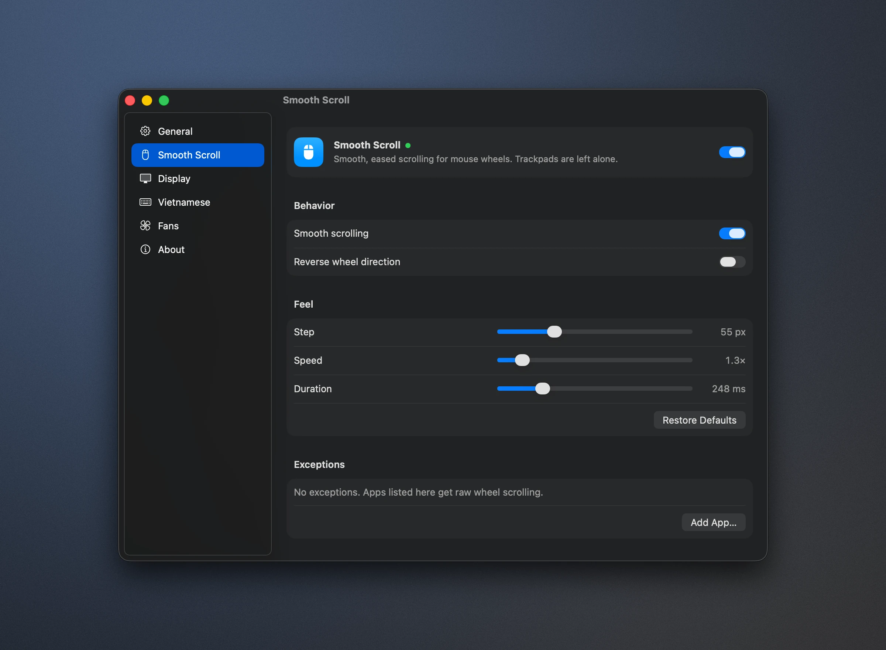</td>
    <td width="50%">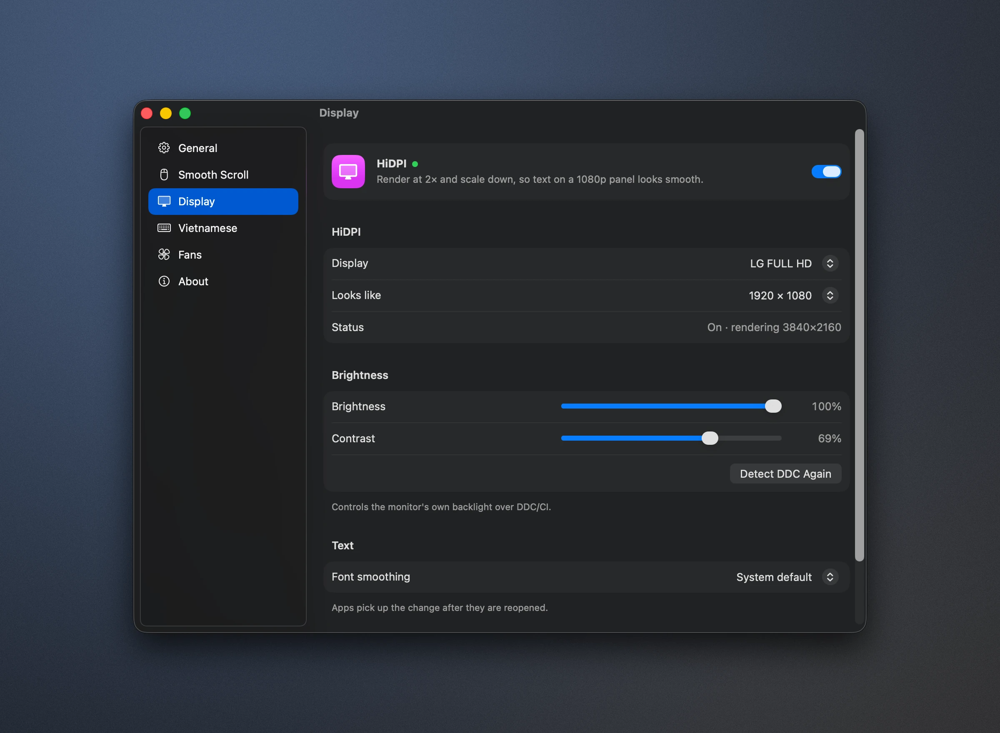</td>
  </tr>
  <tr>
    <td align="center">Cuộn mượt</td>
    <td align="center">Màn hình</td>
  </tr>
  <tr>
    <td width="50%">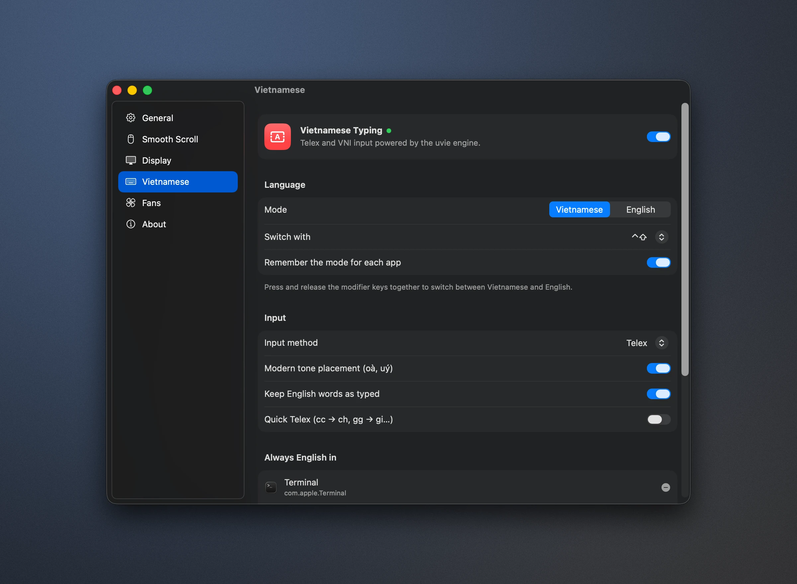</td>
    <td width="50%">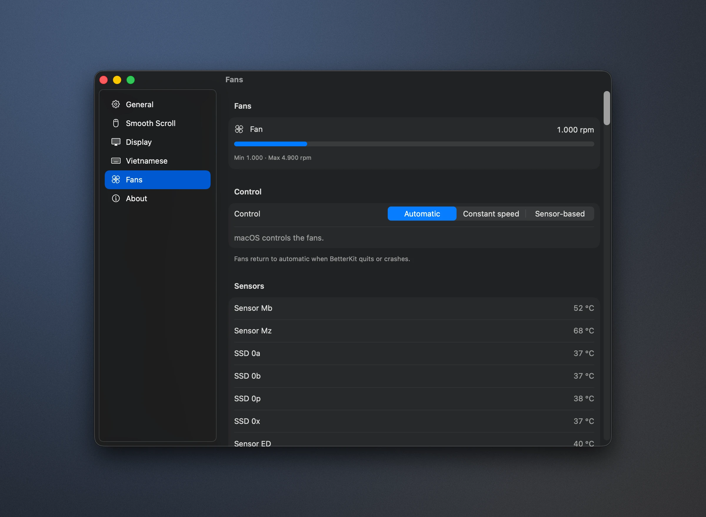</td>
  </tr>
  <tr>
    <td align="center">Gõ tiếng Việt</td>
    <td align="center">Quạt</td>
  </tr>
  <tr>
    <td width="50%">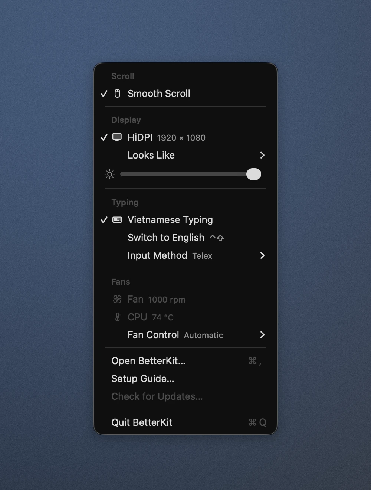</td>
    <td width="50%">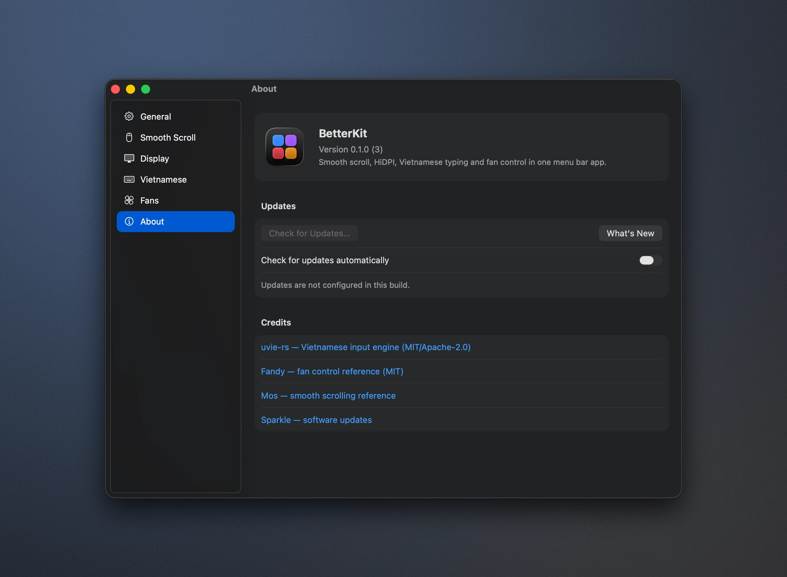</td>
  </tr>
  <tr>
    <td align="center">Thanh menu</td>
    <td align="center">Giới thiệu</td>
  </tr>
</table>

Giao diện ứng dụng hiện bằng tiếng Anh; tên các mục trong hướng dẫn dưới đây được giữ nguyên để dễ đối chiếu.

## Cài đặt

1. Mở `BetterKit-<version>.dmg` và kéo **BetterKit** vào thư mục **Applications**.
2. Mở BetterKit. Lần chạy đầu tiên sẽ hiện cửa sổ thiết lập:
   - Bật những công cụ bạn muốn dùng.
   - **Accessibility:** bấm **Grant**. System Settings mở ra cạnh một bảng nhỏ. Kéo biểu tượng BetterKit từ bảng đó vào danh sách rồi bật lên. Cuộn mượt và gõ tiếng Việt cần quyền này.
   - **Điều khiển quạt:** mở mục **Fans** trong BetterKit và bấm **INSTALL** cạnh fan helper. macOS sẽ yêu cầu cho phép BetterKit tại *Login Items & Extensions › Allow in the Background*; bảng hướng dẫn chỉ rõ vị trí. Nếu dòng trạng thái vẫn đang chờ, bấm **APPROVE**.
   - **Open at login** được bật sẵn.
3. Thoát các ứng dụng cũ có cùng chức năng để tránh xung đột.

Mọi chức năng đều nằm trong biểu tượng trên thanh menu (biểu tượng lưới kèm chữ **V** hoặc **E**). **Open BetterKit…** (⌘,) mở toàn bộ cài đặt, **Setup Guide…** mở lại cửa sổ thiết lập.

## Lưu ý khi sử dụng

- **HiDPI:** chọn *Display › HiDPI* trong menu, sau đó chọn kích thước tại *Looks Like*.
- **Vị trí dấu:** *Modern tone placement* đặt dấu trên nguyên âm chính (`hoà`, `thuỷ`). Tắt tùy chọn này trong cài đặt Vietnamese để dùng kiểu cũ (`hòa`, `thủy`).
- **Ứng dụng loại trừ:** Terminal và mọi ứng dụng trong danh sách *Always English in* luôn gõ tiếng Anh, bất kể chế độ hiện tại.
- **Quạt** luôn trở về chế độ tự động khi BetterKit thoát hoặc gặp sự cố.

## Gỡ cài đặt

1. Chọn *Fans › Fan Control › Automatic*, rồi thoát BetterKit.
2. Xóa BetterKit khỏi *System Settings › General › Login Items & Extensions* và *Privacy & Security › Accessibility*.
3. Chuyển `/Applications/BetterKit.app` vào Thùng rác.

## Khắc phục sự cố

| Hiện tượng | Cách xử lý |
| --- | --- |
| Cuộn hoặc gõ ngừng hoạt động sau khi cập nhật | Xóa BetterKit khỏi *Accessibility* bằng nút **–**, sau đó cấp quyền lại. |
| Fan helper đang chờ phê duyệt | Cho phép BetterKit tại *Login Items & Extensions › Allow in the Background*, rồi bấm **APPROVE** trong mục **Fans**. |
| Màn hình bị mờ hoặc kẹt ở chế độ phản chiếu | Tắt rồi bật lại HiDPI từ menu. Thoát BetterKit luôn gỡ màn hình ảo. |

## Phát triển

Hướng dẫn build, cấu trúc dự án, gỡ lỗi và quy trình phát hành nằm trong [docs/development.md](docs/development.md) (tiếng Anh).

## Ghi nhận

- [uvie-rs](https://github.com/uvie-project/uvie-rs): bộ gõ tiếng Việt (MIT / Apache-2.0).
- [Fandy](https://github.com/NidaleNieve/Fandy_MacOS) và Macs Fan Control: tham khảo cho điều khiển quạt qua SMC.
- [Mos](https://github.com/Caldis/Mos): tham khảo cho cuộn mượt.
- [Sparkle](https://sparkle-project.org): cập nhật phần mềm.
